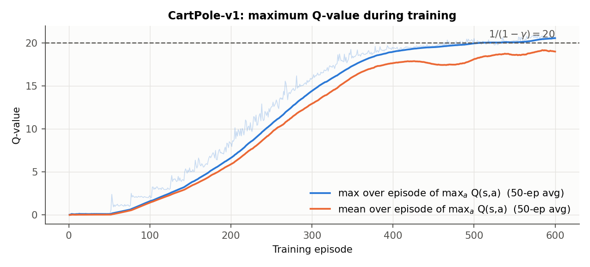
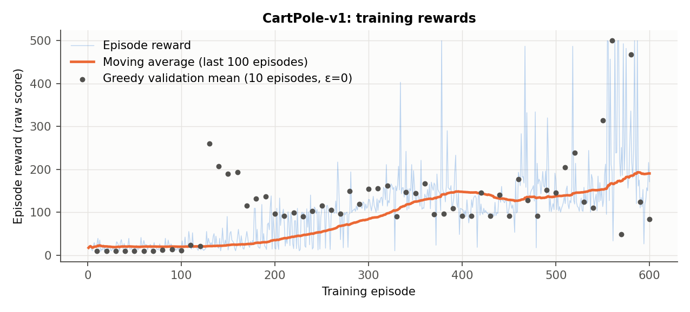
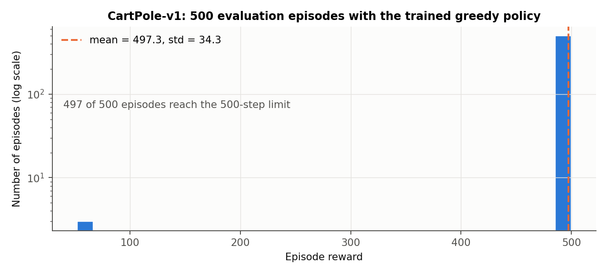
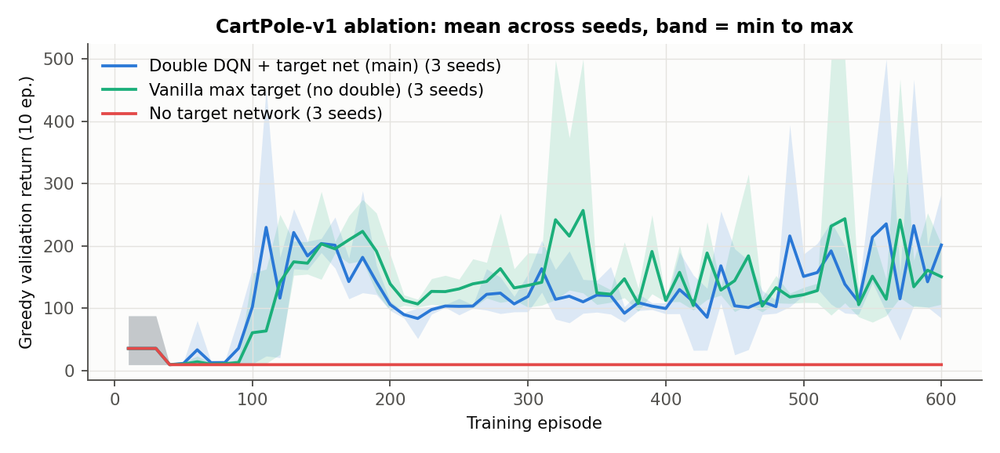
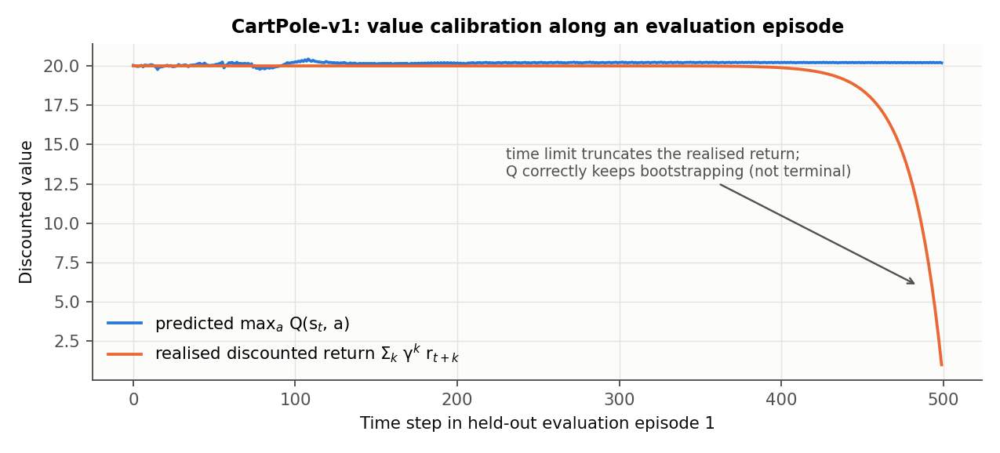

# 3. Part (a): CartPole-v1 ($\gamma = 0.95$)

**Final model.** Main configuration from `run_all.sh`, seed 1 (`results/cartpole_s1`): lr $10^{-3}\to10^{-4}$, batch 64, target copy every 500 updates, 600 episodes.
We kept the checkpoint with the best greedy validation score (episode 560, 10/10 validation episodes at 500). We confirmed it on a second, independent validation set (seeds 200000+, 50/50 episodes at 500) before touching the test seeds.

**(iii) 500 roll-outs (test seeds 100000–100499, greedy):**
**mean = 497.34, standard deviation = 34.27, median = 500; 497/500 episodes (99.4%) reach the 500-step limit.** The environment is solved.

{width=88%}

**(i) Q-values.** Every step pays +1, and a never-failing policy only ever stops by time-limit truncation, which is *not* terminal. So the optimal value is $Q^*=\sum_k \gamma^k = 1/(1-0.95) = 20$. The learned maximum Q rises smoothly from 0 and **levels off right at 20** (dashed line). At start states of the final model its mean is **20.01**. Overshooting 20 would indicate over-estimation; levelling off well below 20 would mean truncation was being treated as terminal.

{width=88%}

**(ii) Rewards.** The 100-episode moving average climbs from about 20 (random play) to about 190 by episode 600. The greedy validation points (black) show what the policy can do without exploration noise: they reach 500 at episode 560 and 467 at episode 580. Training rewards understate the policy. Even at $\varepsilon = 0.01$ one random action can start a fall, and the T4 noise test shows that $\varepsilon = 0.05$ already costs about 19% of the return.

{width=88%}

**Stability across seeds and hyper-parameters.** DQN on CartPole is well known to oscillate after first solving it, and $\gamma=0.95$ makes this worse (edge case 8). To report this honestly rather than show one lucky run, we trained **27 runs**: the main configuration, two ablations and six sweep configurations, each with 3 seeds. The table counts how often the greedy validation return hit 500.

%%SWEEP_TABLE%%

Every configuration with a target network produced a 500-validation checkpoint in at least one seed, while **none** of the 9 no-target checkpoints exceeded 88. Configurations that do more or larger gradient updates per sample were the most reliable: C (2 updates per step) and D (batch 256) solved in **3/3 seeds**, and C hit 500 at 23 validation checks. That fits the action-gap explanation in edge case 8: Q must be learned very precisely before the tiny difference between "push left" and "push right" in safe states rises above the noise. No configuration stays at 500 permanently ("mean val., 2nd half" is 138–259), and the dueling head (F) did not fix this. Checkpoint selection on validation seeds is what turns an oscillating learner into a reliable policy.

{width=88%}

**Non-standard plot: value calibration.** Below we compare the predicted $\max_a Q(s_t,a)$ with the return the agent *actually* collected afterwards in a held-out episode. For 450 steps the two agree at about 20, so the network has learned the true discounted value. In the last 50 steps the realised return collapses only because the 500-step time limit cuts the episode short. Q correctly does *not* fall: that state is not terminal, the policy could keep balancing, and we never mask truncations. Had we treated truncation as terminal, Q would have learned to predict this artificial drop from the state alone, which it cannot see, so the target would be noisy.

{width=88%}

**First 10 steps of a held-out episode** (`results/cartpole_s1/evaluation/first10.json`):

| t | x | ẋ | θ | θ̇ | Q(left) | Q(right) | action |
|---|---|---|---|---|---|---|---|
| 1 | −0.037 | −0.003 | 0.050 | 0.032 | 19.99 | 20.03 | right |
| 2 | −0.038 | 0.191 | 0.050 | −0.245 | 19.98 | 20.01 | right |
| 3 | −0.034 | 0.386 | 0.045 | −0.521 | 19.95 | 19.97 | right |
| 4 | −0.026 | 0.580 | 0.035 | −0.799 | 19.91 | 19.96 | right |
| 5 | −0.014 | 0.775 | 0.019 | −1.080 | 19.90 | 19.99 | right |
| 6 | 0.001 | 0.970 | −0.002 | −1.367 | 20.01 | 20.04 | right |
| 7 | 0.021 | 1.165 | −0.030 | −1.661 | 19.94 | **12.16** | **left** |
| 8 | 0.044 | 0.970 | −0.063 | −1.377 | 20.05 | 15.60 | left |
| 9 | 0.063 | 0.776 | −0.091 | −1.105 | 20.04 | 18.38 | left |
| 10 | 0.079 | 0.582 | −0.113 | −0.842 | 20.02 | 19.56 | left |

The pole starts leaning right ($\theta>0$), so the agent pushes right to get under it. Once the pole has swung past vertical and is falling left fast ($\dot\theta=-1.66$), another push right would be fatal. Q(right) drops to 12.2, about 8 points below Q(left), and the agent switches. While the state is safe the two actions differ by only about 0.05, the tiny action gap discussed in edge case 8.
