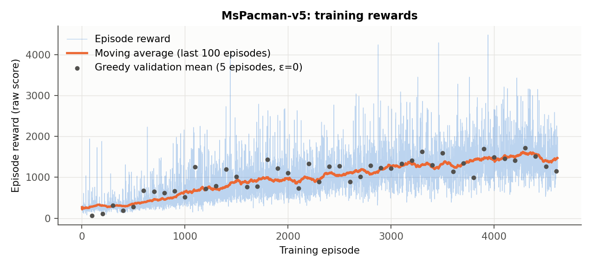
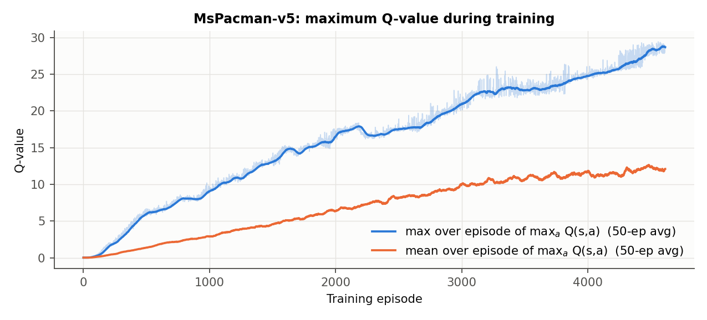
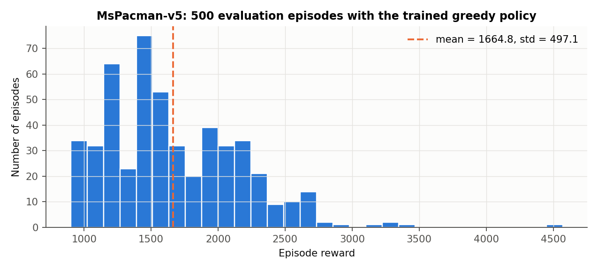
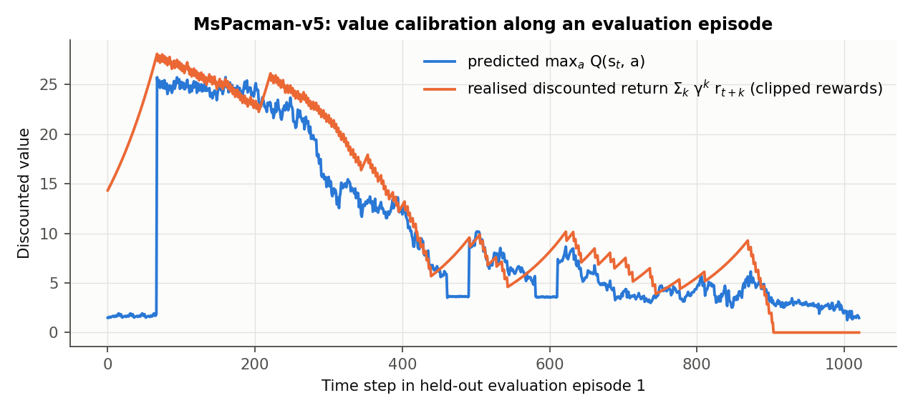
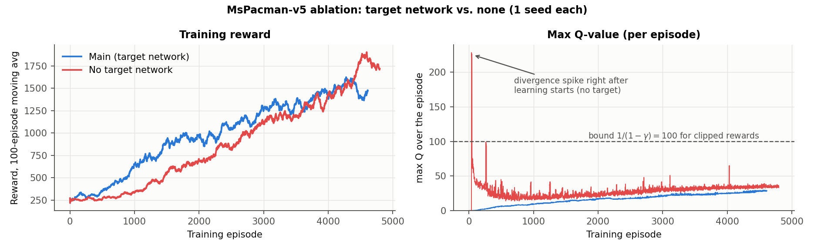

# 4. Part (b): MsPacman-v5 ($\gamma = 0.99$)

**Training run** (`results/mspacman`, one RTX 2080 Ti): **4,614 episodes**, 3.13M agent steps (12.5M emulator frames at frame-skip 4), 776k gradient updates, and a 2.5-hour wall-clock budget set by the deadline. The run stopped on that budget, not because learning had levelled off.
The checkpoint with the best greedy validation score (episode 4,300, mean 1,720 over 5 validation seeds) was evaluated on 500 held-out seeds.

**(iii) 500 roll-outs (test seeds 100000–100499, greedy, sticky actions on):**
**mean = 1,664.8, standard deviation = 497.1**, median 1,570, min 900, max 4,570. For reference, a uniformly random policy scores %%MSP_RANDOM%% on the same game (T4, $\varepsilon=1$). Even the trained agent's *worst* test episode (900) is far above that.

{width=88%}

**(ii) Rewards: clear learning.** The 100-episode moving average rises from **282** (first 100 episodes, essentially random play) to **1,473** (last 100), peaking near 1,600 around episode 4,300. The trend holds at every stage of the $\varepsilon$ schedule. At first the gains come from the policy itself while $\varepsilon$ is still above 0.5 (episodes 500–1,000; $\varepsilon=0.5$ at episode 1,013). They continue after $\varepsilon$ reaches its floor (0.1 at about episode 1,700, then 0.01). The greedy validation means (black dots, 5 episodes each, so noisy) track the moving average.

{width=88%}

**(i) Q-values.** Q rises smoothly and monotonically as the agent learns to collect more reward per life, from 0 to a per-episode maximum of about 29 and an episode mean of about 12. There are no spikes and no plateau at an implausible level. With rewards clipped to $\{-1,0,1\}$ and $\gamma=0.99$, $|Q|\le 100$ always holds. 29 is consistent with eating about one pellet every two steps for a while ($\sum_k 0.99^{2k}\approx 50$), discounted by the chance of dying. The curve had not levelled off when the time budget ran out, consistent with the reward curve.

{width=88%}

The distribution is clearly multi-modal, with peaks near 1,200, 1,450 and 2,000. In Ms. Pac-Man a run's score is dominated by *discrete* events: whether the agent clears the first maze (all pellets) and how many ghosts it eats after a power pellet (200/400/800/1,600). So scores cluster by how many such events happened rather than spreading as a bell curve.

**Non-standard plot: value calibration on a held-out episode.** Through most of the game, predicted $\max_a Q$ tracks the realised discounted (clipped) return closely. Over the 20 calibration episodes the correlation is %%MSP_CORR%%. The visible failure is instructive: during the **frozen screens** at the start of the game and after each lost life (flat blue segments at steps 0–65, about 460–490 and about 580–610), Q falls to 2–4 while the true value is 5–25. On those screens nothing moves and the 4-frame stack holds 4 identical frames, so the network cannot "see" how far the freeze has progressed. It also receives zero reward for about 65 steps, so the value must be bootstrapped through a long chain of indistinguishable states. Section 7 lists a targeted fix.

{width=88%}

**Target-network ablation: score vs. correctness of values.** We trained an identical second agent *without* a target network (bootstrapping from the online network), on a second GPU, for the same 2.5 hours (Fig. 10). Unlike CartPole, it did **not** collapse. It learned more slowly at first, then overtook the main run late and scored **%%NT_MEAN%% ± %%NT_STD%%** on the same 500 test seeds, against 1,664.8 ± 497.1. The value estimates, however, show the problem the target network is meant to prevent:

| | main (target net + Double DQN) | no target network |
|---|---|---|
| test score (500 ep.) | 1,664.8 ± 497.1 | %%NT_MEAN%% ± %%NT_STD%% |
| mean predicted Q vs. realised return (20 eval. ep.) | %%M_Q%% vs. %%M_G%% (**under**-estimates) | %%N_Q%% vs. %%N_G%% (**over**-estimates by %%N_OVER%%%) |
| largest Q seen during training | %%M_QMAX%% | **%%N_QMAX%%**, above the hard bound of 100 |

Right after learning starts, the no-target network **diverged**: Q exceeded 220 for 8 straight episodes, impossible for clipped rewards. It recovered only because the learning rate is small and gradients are clipped. It then remained about 45% optimistic and spiky for the rest of training. The target network kept Q bounded, smooth and slightly pessimistic, the known effect of Double DQN. **With one seed per arm we cannot claim either agent scores better.** CartPole (3/3 no-target seeds collapsed) and the bound violation here both show that the target network is what keeps the regression target stable. Running more seeds of this comparison is the first item in Section 7.

{width=100%}
