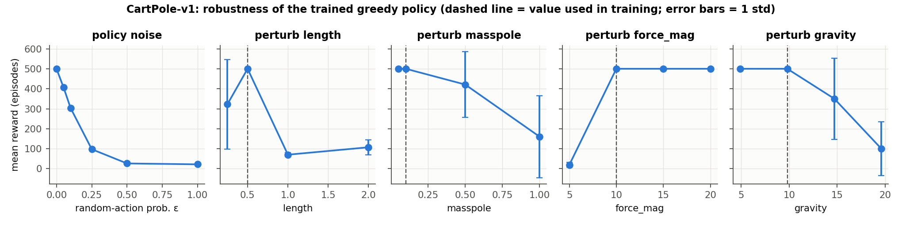
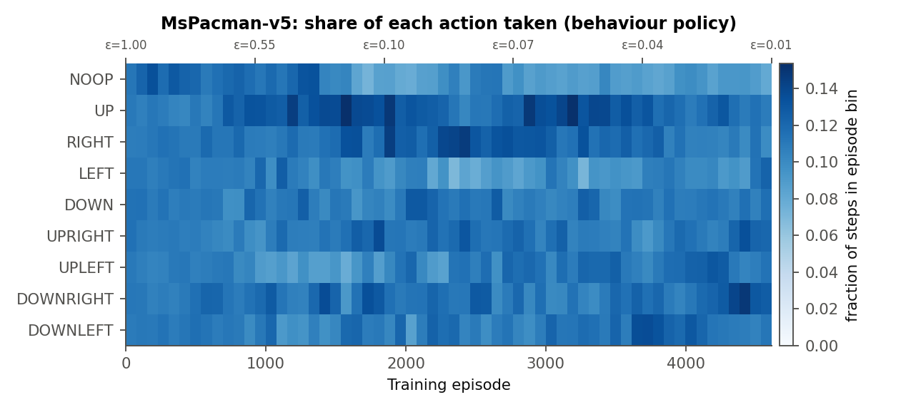

# 5. Tests for validating correctness

Each test changes something whose effect we can **predict in advance**, then checks that the implementation behaves as predicted. All of them run from `validate.py` (commands in the header) and write JSON to `results/validation/`.

**T1. Analytic chain MDP: does the DQN machinery converge to the right numbers?** (`validate.py analytic`)
A 4-state corridor with one-hot states: "right" from the last state pays +1 and ends the episode, and every other move pays 0. The closed form is $Q^*(s,\text{right})=\gamma^{3-s}$ and $Q^*(s,\text{left})=\gamma\,V^*(\max(s-1,0))$. We train it with the **exact** `ReplayBuffer`, `dqn_update` (Double-DQN + Huber + clipping) and target-network code used for the games.

| $\gamma$ | max \|learned − closed form\| | greedy = optimal? |
|---|---|---|
| 0.00 | %%T1_0%% | yes |
| 0.50 | %%T1_05%% | yes |
| 0.95 | %%T1_095%% | yes |
| 0.99 | %%T1_099%% | yes |
| 0.95, **terminal flag ignored** (deliberate bug) | **%%T1_BUG%%** | values drift toward $1/(1-\gamma)=20$ |

The learned values match the analytic Q* to within 1e-3 for every $\gamma$. The bug variant shows the test is sensitive: drop the $(1-d)$ mask and the same code learns values above 12 where the truth is at most 1.

**T2. Terminal vs. truncated targets.** Feed `td_target` the same $r=1$ and $V(s')=20$ with $\gamma=0.95$. It gives **1.0** when terminated and **20.0** when truncated, matching the expected values exactly. The CartPole Q level of 20.01 (Fig. 1) and the calibration plot (Fig. 4) show the same behaviour end-to-end.

**T3. Pipeline edge cases on the real MsPacman environment** (all pass):
- the Ms. Pac-Man colour (sum 448) is blacked out, and a white pixel (sum 765) maps to 255 with no uint8 wrap-around;
- a reset stack is 4 copies of the first frame, both at the start and for a new episode inside the vector env;
- at the first real game-over (step 478 of a random roll-out) the stored $s'$ frame equals `info["final_obs"]`, differs from the reset frame, and has `terminated = 1`;
- $s'$ rebuilt from $(s, \text{new frame})$ in the replay buffer is bit-identical to the true next stack for every transition.

**T4. Policy-noise intervention** (`validate.py cartpole` / `mspacman`, 100 and 30 paired seeds).
*Prediction:* if the greedy action really carries the learned value, return falls monotonically as we replace it with random actions, and $\varepsilon=1$ matches a random policy.

| $\varepsilon$ at test time | 0 | 0.05 | 0.1 | 0.25 | 0.5 | 1.0 |
|---|---|---|---|---|---|---|
| CartPole mean reward | %%E0%% | %%E005%% | %%E01%% | %%E025%% | %%E05%% | %%E1%% |
| CartPole fraction at 500 | %%F0%% | %%F005%% | %%F01%% | %%F025%% | %%F05%% | %%F1%% |

%%MSP_NOISE%%

**T5. Changing the physics** (CartPole, 30 episodes per setting, Fig. 5).
*Prediction:* the policy implicitly encodes the dynamics, so it should be perfect at the training values and degrade as constants move away. "Easier" changes (lighter pole, weaker gravity, stronger motor) should hurt less than "harder" ones.
Measured: 500/500 at the training physics. Halving gravity (4.9), a lighter pole (0.05) and a stronger motor (force 15 or 20) are all still perfect. A weaker motor (force 5) collapses to %%FORCE5%% steps, a 5x heavier pole (0.5) drops to %%MASS05%%, and doubled gravity to %%G196%%. Changing the pole *length* in either direction hurts, because the policy's timing is tuned to that pendulum period. This matches the prediction and shows the agent is a control law tuned to the training dynamics, not a lookup of memorised trajectories.

{width=100%}

**T6. Mirror symmetry (a negative finding).** CartPole's dynamics are symmetric under $s\to-s$ with left$\leftrightarrow$right, so we expected a correct Q to flip its greedy action on mirrored states. Measured flip rate: **%%MIRROR%%** on confident states, barely above chance. The cause is the data, not the code. The final policy parks the cart left of centre (mean $x=-0.91$; **95% of visited states have $x<0$**), so mirrored states ($x\approx+0.9$) are almost never in the replay buffer. DQN only learns Q where it has data. This also explains the x-boundary failures in T8. A cheap fix would be to augment the buffer with mirrored transitions (Section 7).

**T7. Q-level vs. theory.** CartPole: the learned $\max_a Q$ at start states is **20.01** against the theoretical 20.00 (0.05% error). MsPacman: with clipped rewards, $|Q|\le 1/(1-0.99)=100$. %%MSP_QTHEORY%%

**T8. Failure-mode diagnosis (CartPole).** We replayed 20 held-out episodes from the best and the final (episode 600) checkpoints of the three main-config seeds and recorded *why* each episode ended:

| checkpoint (main config) | mean length | ended by pole angle | ended by \|x\| > 2.4 | truncated at 500 |
|---|---|---|---|---|
| best of seed 0 (ep 180) | 298 | 20 | 0 | 0 |
| best of seed 2 (ep 110) | 415 | 19 | 0 | 1 |
| best of seed 1 (ep 560, final model) | 500 | 0 | 0 | 20 |
| last of seed 0 (ep 600) | 224 | 4 | **16** | 0 |
| last of seed 1 (ep 600) | 91 | 1 | **19** | 0 |
| last of seed 2 (ep 600) | 286 | 1 | **16** | 3 |

(`validate.py failure_modes`, 20 held-out episodes each, output in `results/validation/failure_modes.json`.)

Early checkpoints fail because the pole falls. By episode 600 the agent has learned to balance, and 51 of the 60 episodes end because the cart *drifts off the track*. That is precisely the long-horizon failure predicted by $\gamma=0.95$: the cost of drifting is discounted below the noise in Q (edge case 8). It is why the learning curves oscillate and why we select checkpoints by validation.

**T9. Ablations (Figs. 3 and 8).** Removing the target network makes CartPole learning collapse: all 3 seeds end with greedy return of about 9, the minimum possible, because Q chases its own moving target and diverges. %%MSP_ABL%%

# 6. Plot that is non-standard

Besides the Q-calibration plots (Figs. 4 and 9) and the robustness panel (Fig. 5), the figure below shows **how the behaviour policy's action distribution evolves** during MsPacman training. Each column is a block of episodes, and colour is the share of steps on which each of the 9 joystick actions was chosen. The top axis shows $\varepsilon$.
While $\varepsilon\approx1$ all actions are equally likely (uniform colour). As $\varepsilon$ falls, the greedy preferences take over. %%HEATMAP_TEXT%%

{width=88%}

# 7. With 3 more months: further validation tests and experiments

1. **Statistical rigour.** 10+ seeds per configuration, with bootstrap confidence intervals (e.g. interquartile mean, as in the `rliable` protocol) instead of single-seed curves, and a permutation test for "Double-DQN vs. vanilla".
2. **Over-estimation audit.** For both games, measure the gap between predicted Q and Monte-Carlo return over the whole visited-state distribution for vanilla vs. Double DQN, and how it grows with the number of actions. Compare against the analytical bias of a max over noisy estimates.
3. **Mirror-augmented replay for CartPole.** Add $(-s, 1-a, r, -s')$ for each transition and test whether T6's flip rate goes to 1 and the x-drift failures (T8) disappear.
4. **Horizon test.** Train CartPole with $\gamma\in\{0.9, 0.95, 0.99, 0.995\}$ and check whether the share of x-boundary failures falls as $1/(1-\gamma)$ grows, a direct test of the edge-case-8 explanation.
5. **Longer MsPacman training (10–50M frames)** with Rainbow components (prioritised replay, n-step returns, dueling, distributional C51, noisy nets), one at a time, to measure each contribution.
6. **Generalisation tests for MsPacman.** Other mazes/levels, no sticky actions vs. sticky 0.25, and different `repeat_action_probability` and `frameskip` values. This separates memorised routes from a reactive policy.
7. **Interpretability.** Saliency or Grad-CAM maps over the frame stack to check that Q attends to ghosts, pellets and Ms. Pac-Man rather than to the score digits. A **controlled-state test**: place a ghost next to Ms. Pac-Man in a saved emulator state and check that Q of the action moving toward it drops.
8. **Replay diagnostics.** Distribution of sample age and TD-error over training; buffer-size sweep to check whether catastrophic forgetting (early failures pushed out of the buffer) drives the CartPole oscillations.
9. **Hyper-parameter search** (Bayesian optimisation / successive halving) over learning rate, target period, replay ratio and $\varepsilon$ schedule, with checkpoint selection always done on validation seeds disjoint from test seeds.
